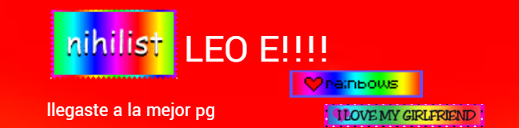

# PARASITE — EXHIBITION MODE

**An autonomous browser organism navigating the Wrong Internet.**

**Un organismo autónomo que navega por la Internet equivocada.**

---

## Exhibition Mode — CAD 2026

**PARASITE — Exhibition Mode** was developed specifically for its presentation at the **Congreso Argentino de Digitalidad (CAD 2026)**, scheduled for November 21, 2026, in Buenos Aires, Argentina.

This version extends the original browser organism into an autonomous exhibition environment. PARASITE can navigate between websites, explore hyperlinks, transform its visual surroundings, and continue operating without continuous human intervention.

The exhibition version also introduces an offline survival system and encounters with a specially created network of webpages, images, and musical references.

[Congreso Argentino de Digitalidad — Official Website](https://elcad.com.ar/)

---

## 🌈 ★ A VERY SPECIAL THANK YOU TO LEO!!! ★ 🌈

  

  <strong>★ ENTER LEO'S WEB UNIVERSE!!! ★</strong>

  <a href="https://wipparasito.straw.page/leo">
    https://wipparasito.straw.page/leo
  </a>

**An enormous thank you to Leo**, whose creativity, imagination, and collaboration have become an essential part of PARASITE — Exhibition Mode.

Leo created an independent universe of webpages, images, visual references, unexpected links, and musical selections that PARASITE can encounter during its autonomous navigation.

His contribution introduces a visual and cultural language radically different from PARASITE's own technical aesthetic. This contrast is deliberate: neither universe is required to resemble or assimilate into the other.

What began as an independent contribution became an integral part of the exhibition experience, transforming the ways PARASITE encounters, navigates, and sounds within the web.

**Thank you, Leo, for bringing your own world into PARASITE.**

---

### Installation

PARASITE — Exhibition Mode is a Chrome extension developed using Manifest V3.

The exhibition version has been tested on Google Chrome 109 running on Windows 7.

**Installation steps:**

1. Download or clone the PARASITE-EXHIBITION repository.
2. Open Google Chrome.
3. Navigate to `chrome://extensions`.
4. Enable **Developer Mode**.
5. Click **Load unpacked**.
6. Select the downloaded or cloned project folder containing `manifest.json`.
7. Open a website and activate Exhibition Mode using the PARASITE extension icon.

### Autonomous and Human Modes

**AUTO — Autonomous Mode**

PARASITE explores hyperlinks, moves across webpages, navigates between websites, and develops its visual behavior without requiring continuous human intervention.

The organism can encounter a curated network of webpages created by Leo, introducing unexpected visual and musical material into its navigation.

**HUM — Human Mode**

Autonomous exhibition navigation is disabled. Visitors can navigate and interact with websites while PARASITE maintains its original behavior.

The extension icon indicates the selected mode.

### Offline Survival

When Internet connectivity is interrupted, PARASITE can enter a sequence of survival states:

`UNSTABLE → STARVATION → NEAR_DEATH → DORMANCY`

During prolonged disconnection, the organism continues operating within a local environment, preserving residual visual and sonic activity.

When connectivity returns, the system attempts to recover its online navigation.

### Exhibition Notes

- Exhibition Mode operates autonomously within a selected browser tab.
- Some browser pages and websites may restrict extension functionality.
- Internet connectivity is required to access external websites.
- Extended offline operation and automatic recovery depend on browser and system conditions.
- Audio resources must be available locally for their corresponding sounds to function.

---

## Modo Exhibición — CAD 2026

**PARASITE — Modo Exhibición** fue desarrollado específicamente para su presentación en el **Congreso Argentino de Digitalidad (CAD 2026)**, previsto para el 21 de noviembre de 2026 en Buenos Aires, Argentina.

Esta versión extiende el organismo original del navegador hacia un entorno expositivo autónomo. PARASITE puede navegar entre sitios web, explorar hipervínculos, transformar visualmente su entorno y continuar operando sin necesidad de intervención humana constante.

La versión de exhibición incorpora también un sistema de supervivencia sin conexión a Internet y encuentros con una red de páginas web, imágenes y referencias musicales creada especialmente para el proyecto.

[Congreso Argentino de Digitalidad — Sitio oficial](https://elcad.com.ar/)

---

## 🌈 ★ UN AGRADECIMIENTO MUY ESPECIAL A LEO!!! ★ 🌈

  <strong>★ EXPLORÁ EL UNIVERSO WEB DE LEO!!! ★</strong>

  <a href="https://wipparasito.straw.page/leo">
    https://wipparasito.straw.page/leo
  </a>

**Un agradecimiento enorme a Leo**, cuya creatividad, imaginación y colaboración se convirtieron en una parte fundamental de PARASITE — Modo Exhibición.

Leo creó un universo independiente de páginas web, imágenes, referencias visuales, enlaces inesperados y selecciones musicales que PARASITE puede encontrar durante su navegación autónoma.

Su contribución introduce un lenguaje visual y cultural radicalmente diferente de la estética técnica de PARASITE. Este contraste es deliberado: ninguno de los dos universos necesita parecerse al otro ni asimilarse a su lenguaje.

Lo que comenzó como una contribución independiente se convirtió en una parte integral de la experiencia expositiva, transformando las maneras en que PARASITE encuentra, recorre y hace sonar la web.

**Gracias, Leo, por traer tu propio universo a PARASITE.**

---

### Instalación

PARASITE — Modo Exhibición es una extensión para Google Chrome desarrollada mediante Manifest V3.

La versión de exhibición fue probada en Google Chrome 109 sobre Windows 7.

**Pasos de instalación:**

1. Descargar o clonar el repositorio PARASITE-EXHIBITION.
2. Abrir Google Chrome.
3. Ingresar a `chrome://extensions`.
4. Activar el **Modo de desarrollador**.
5. Seleccionar **Cargar descomprimida**.
6. Elegir la carpeta del proyecto descargado o clonado que contiene `manifest.json`.
7. Abrir un sitio web y activar Exhibition Mode mediante el ícono de PARASITE.

### Modos autónomo y humano

**AUTO — Modo autónomo**

PARASITE explora hipervínculos, se desplaza por las páginas, navega entre diferentes sitios web y desarrolla su comportamiento visual sin necesidad de intervención humana constante.

El organismo puede encontrarse con una red de páginas curadas creadas por Leo, incorporando materiales visuales y musicales inesperados a su recorrido.

**HUM — Modo humano**

La navegación autónoma de exhibición queda desactivada. Los visitantes pueden navegar e interactuar con los sitios web mientras PARASITE mantiene su comportamiento original.

El ícono de la extensión indica el modo seleccionado.

### Supervivencia sin conexión

Cuando se interrumpe Internet, PARASITE puede atravesar una secuencia de estados de supervivencia:

`UNSTABLE → STARVATION → NEAR_DEATH → DORMANCY`

Durante una desconexión prolongada, el organismo continúa operando dentro de un entorno local, conservando una actividad visual y sonora residual.

Cuando vuelve la conectividad, el sistema intenta recuperar la navegación en línea.

### Consideraciones para la exhibición

- El modo autónomo funciona en una pestaña seleccionada del navegador.
- Algunas páginas y sitios web restringen el funcionamiento de las extensiones.
- La navegación hacia sitios externos requiere conexión a Internet.
- El funcionamiento offline prolongado y la recuperación automática dependen de las condiciones del navegador y del sistema.
- Los recursos sonoros deben estar disponibles localmente para poder reproducirse.

---

**PARASITE — Exhibition Mode / CAD 2026**

[Original PARASITE repository](https://github.com/Natzuko/PARASITE) · [Leo's Web Universe](https://wipparasito.straw.page/leo) · [CAD 2026](https://elcad.com.ar/)